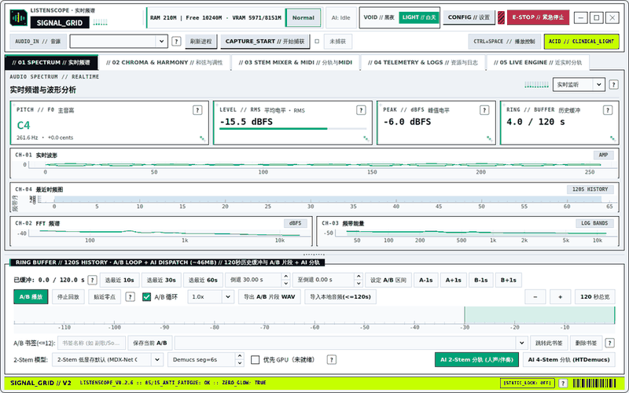

<div align="center">

<picture>
  <source media="(prefers-color-scheme: dark)" srcset="docs/design/icon/listenscope_master_dark.svg" />
  
</picture>

# ListenScope

A **free · offline · local-first** Windows workstation for music listening analysis, A/B looping, and transcription practice

[简体中文](README.md) · English · [한국어](README.ko.md) · [日本語](README.ja.md)

<a href="https://github.com/Ceph-learner/ListenScope/releases"></a>

<a href="LICENSE"></a>

</div>

<br />

No encrypted cache downloads and no virtual audio cable. While you listen in any player or browser, ListenScope captures the playing audio through standard Windows audio APIs and provides real-time spectrum and pitch analysis, chord and key detection, a 120-second A/B slow-down loop, local AI stem separation, and Cubase-compatible MIDI export.

<p align="center">
  
</p>

---

## Quick Start

No command line required:

1. **Download**: Get the installer `ListenScope-Setup-Windows-x64.exe` or the portable `ListenScope-Core-Windows-x64-Portable.zip` from [Releases](https://github.com/Ceph-learner/ListenScope/releases).
2. **Launch**: Run `ListenScope.exe`. Live spectrum, chord / key / BPM detection, the 120-second A/B loop, and the metronome **work out of the box — no dedicated GPU required**.
3. **Set up AI stems & MIDI (optional)**: Open **Settings → AI & MIDI**.
   - If PyTorch / Conda is already installed, click **Scan Local PyTorch** to detect it;
   - Otherwise, click **One-Click Setup AI + MIDI** to deploy isolated runtimes, then restart when prompted.
4. **Start capturing**: Choose the app that is playing music from the source drop-down in the top bar and click **Start Capture**.

> Settings (`settings.json`), workspace cache, and exported WAV / MIDI files are stored **next to the application** by default; nothing extra is written to the `C:\` drive.

<p align="center">
  
</p>

See the [User Guide](docs/USER_GUIDE.en.md) for detailed instructions and typical transcription workflows.

---

## Key Features

| Module | Description |
| :--- | :--- |
| **Live Capture & Spectrum** | Capture a specific player per process, or the whole system via loopback; waveform, FFT / log spectrum, `F0` pitch, and a `-50 ~ +50 cents` tuning bar |
| **Chords, Key & Capo** | 12-bin Chroma heatmap, major / minor triads with chord tones, Roman numerals, chord trail, CPU-only **Capo transposition**, and a 24-key chord practice window (synth preview and `.mid` export) |
| **120s History & A/B Practice** | Always keeps the last 120 seconds (`48 kHz / Stereo`); drag to set an A/B loop, `0.5x–1.25x` pitch-preserving playback, practice bookmarks, Tap-tempo metronome, and practice WAV export |
| **Local AI Stems & Mixer** | On-demand 2-stem (vocals / accompaniment) or 4-stem (vocals / drums / bass / other) separation with 6-second chunks and an emergency stop that frees VRAM; **`0–24 dB` bass solo boost** and lowest-bass-note detection |
| **MIDI Export** | Transcribe a separated stem or any local WAV to MIDI, exported as **Cubase-compatible SMF Type-0 (`480 TPB`)** |
| **Themes & Languages** | One-click light / dark mode and several built-in palettes; UI switches live between **简体中文 / English / 한국어 / 日本語** |

---

## Screenshots

<p align="center">
  
</p>

<table>
<tr>
<td align="center" width="33%"><br /><sub>Dark theme</sub></td>
<td align="center" width="33%"><br /><sub>Chords · Key · Tempo</sub></td>
<td align="center" width="33%"><br /><sub>Stem mixer & MIDI</sub></td>
</tr>
</table>

<p align="center"><sub>All screenshots and the demo are generated with synthetic signals.</sub></p>

---

## Requirements & Known Limitations

| Item | Details |
| :--- | :--- |
| OS | Windows 10 / 11 (64-bit) |
| Per-process capture | Requires Windows 11; on Windows 10, use system loopback to capture all output |
| GPU | Optional, used only for AI stem separation (NVIDIA recommended) |
| Primary test machine | Windows 11 · NVIDIA RTX 5060 Ti 8 GB · 16 GB RAM |

- The default 6-second chunking and three-level memory thresholds are conservatively tuned for the machine above. Other GPUs, integrated graphics, and system configurations have not been broadly tested yet; if you run into compatibility or performance issues, please report your hardware and a diagnostic bundle in [Issues](https://github.com/Ceph-learner/ListenScope/issues).
- The frameless main window does not yet support Windows 11 Snap Layouts (the layout menu shown when hovering the maximize button); this is planned for a future release.
- Release builds are not code-signed yet, so Windows SmartScreen may appear on first launch — click **More info → Run anyway**. You can verify downloads against `SHA256SUMS.txt` in each release.

---

## FAQ

- **Does it work without an NVIDIA GPU?** Yes. Everything except AI stem separation runs on the CPU.
- **No audio captured?** Make sure you selected the app that is actually playing sound, or switch to system loopback.
- **Still running after closing the window?** It may be minimized to the system tray — right-click the tray icon and choose **Exit**.
- **Online Updates:** You can check for updates in **Settings** (automatic checks run at most once every 24 hours by default and can be disabled). Update checks only read public release metadata from GitHub and never upload any data; downloaded packages are automatically verified against `SHA256SUMS.txt` from the release. Release builds are not code-signed yet, so Windows SmartScreen may appear on first launch — click **More info → Run anyway**. You can also download a new release manually (for the portable build, keep `settings.json` and the `exports\` folder).

More answers in the [FAQ](docs/FAQ.en.md) and [Glossary](docs/GLOSSARY.en.md).

---

## Running from Source

To keep the main UI lightweight (all live analysis and A/B practice run without a GPU), the project uses three isolated Python environments:

```text
ListenScope/
├── core/         # Settings & portable paths, i18n, appearance, environment scan, resource guard
├── audio/        # WASAPI capture, 120 s ring buffer, WSOLA time-stretch, metronome, mixer
├── analysis/     # Spectrum / Chroma / chord / key / BPM, bass pitch, MIDI export
├── ai/           # Stem model registry, chunk scheduling, isolated AI subprocess manager
├── separation/   # 2-stem MDX-ONNX and 4-stem HTDemucs backends
├── streaming/    # Experimental near-real-time 2-stem monitoring (off by default)
├── ui/           # PySide6 + PyQtGraph desktop UI
├── packaging/    # PyInstaller specs and dependency constraints
├── scripts/      # Windows one-click setup, hardware probe, installer scripts
└── docs/         # Architecture, decisions, development and packaging docs
```

```powershell
# Windows: set up the Core / AI / MIDI environments and launch
pwsh -ExecutionPolicy Bypass -File scripts\setup_windows.ps1
.\.venv-core\Scripts\python.exe main.py
```

```bash
# Linux / no sound card: run and test with a simulated signal
pip install -r requirements-core.txt pytest
python main.py --simulate
QT_QPA_PLATFORM=offscreen python -m pytest -q --tb=short
```

Docs: [Architecture](docs/ARCHITECTURE.md) · [Decisions](docs/DECISIONS.md) · [Development](docs/DEVELOPMENT.md) · [Testing](docs/TESTING.md) · [Packaging](docs/PACKAGING.md) · [Roadmap](ROADMAP.md) · [Contributing](CONTRIBUTING.md) · [Code of Conduct](CODE_OF_CONDUCT.en.md)

---

## License & Notices

- The source code is released under the [MIT License](LICENSE). Third-party components and their licenses are listed in [THIRD_PARTY_NOTICES.md](THIRD_PARTY_NOTICES.md) and [licenses/](licenses/); algorithm references are in [PROVENANCE.md](docs/PROVENANCE.md).
- The repository and release builds **do not include** any AI model weights. Models such as UVR / MDX-Net, HTDemucs, and Basic Pitch are subject to their own licenses and terms; please review them before downloading.
- Everything runs locally, with no telemetry and no data upload. See [PRIVACY.md](PRIVACY.md).

<details>
<summary>Disclaimer & Trademarks</summary>

<br />

- ListenScope only captures audio that is already playing on your computer through standard system audio APIs. It does not download, decrypt, or bypass any DRM. Please follow local laws and respect the copyright of the audio you work with.
- This project is not affiliated with any music platform, DAW, or hardware vendor. QQ Music, Cubase, NVIDIA, Windows, and other names mentioned are trademarks of their respective owners.
- This software is provided "as is", without warranty of any kind, express or implied.

</details>

---

## Acknowledgments

Thanks to the open-source projects and researchers in audio signal processing, source separation, MIDI transcription, and the Qt desktop ecosystem — ListenScope is built on their work. See [ACKNOWLEDGMENTS.md](ACKNOWLEDGMENTS.md) for the full list and sources.

If you find this tool helpful, a ⭐ is much appreciated, and suggestions and feedback are always welcome via Issues.
