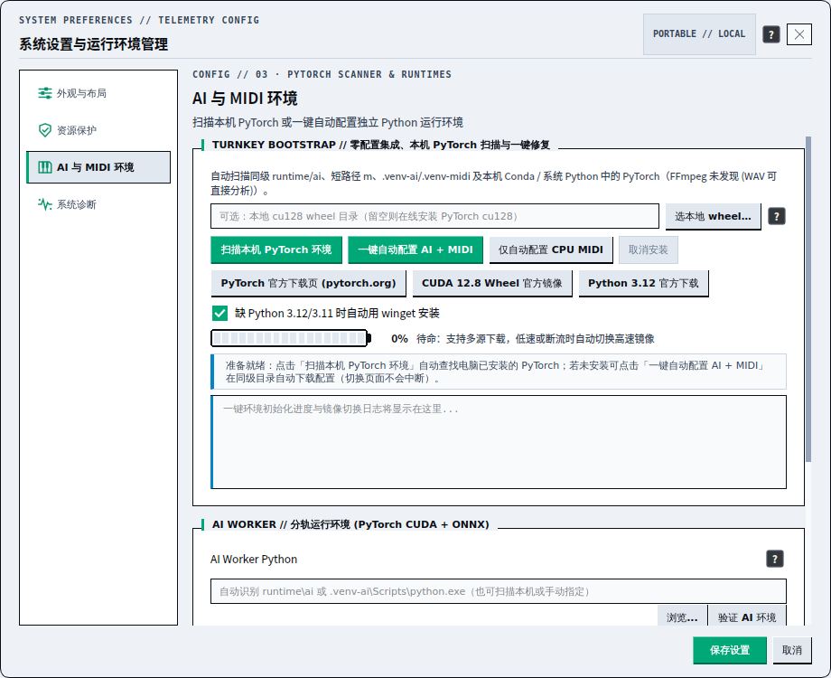
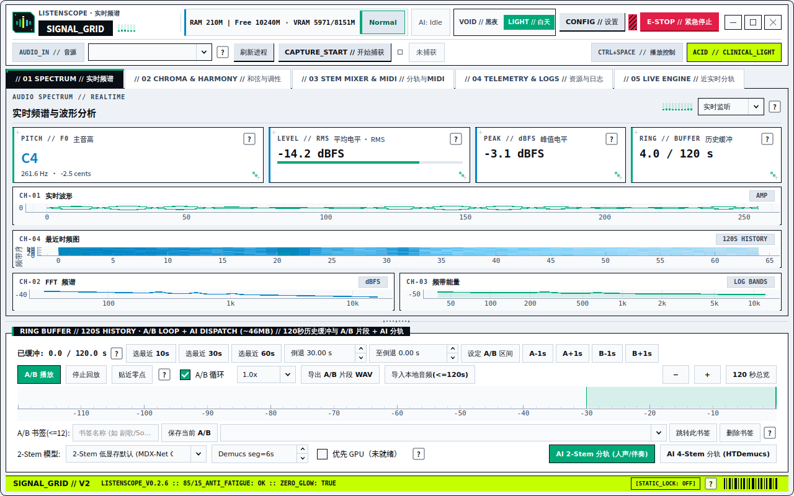
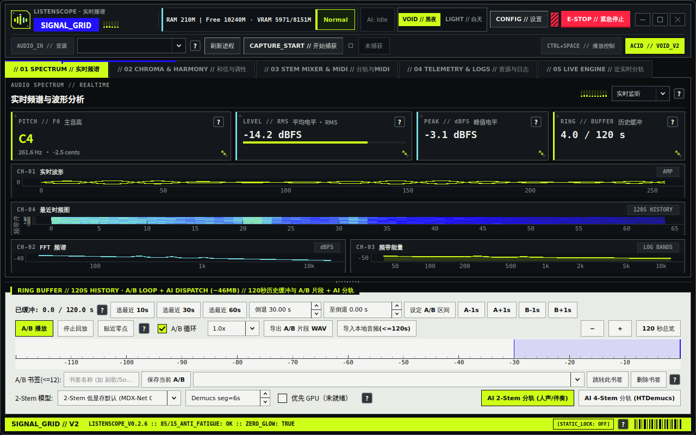
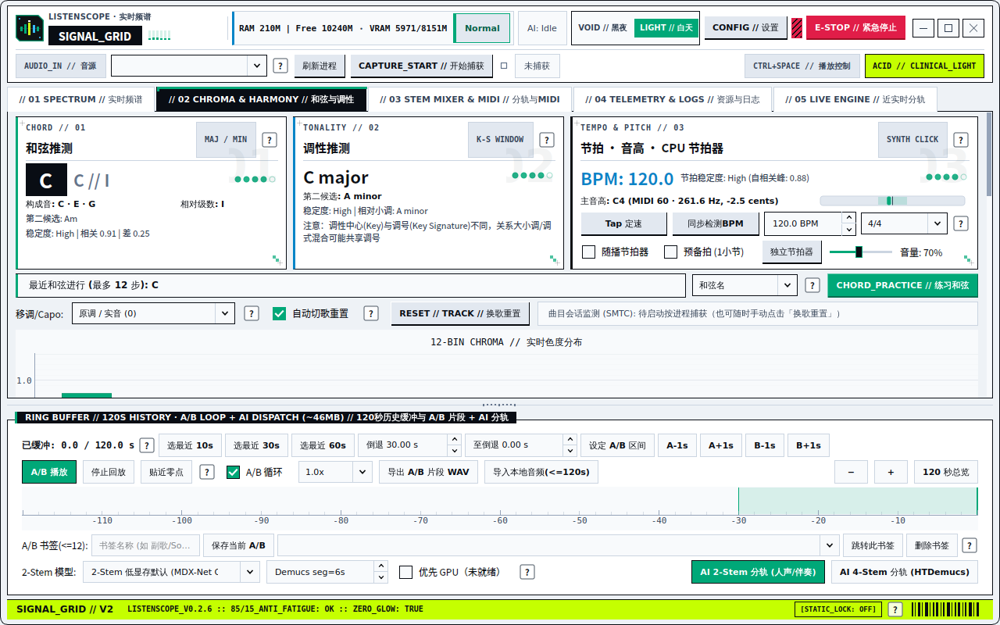

# ListenScope

[简体中文](README.md) | English | [한국어](README.ko.md) | [日本語](README.ja.md)

A **free, offline, local-first** Windows desktop workstation for real-time music analysis, A/B looping, stem separation, and transcription practice.

No encrypted cache downloads or virtual audio driver routing required. While listening in any desktop player or browser, ListenScope captures audio directly per process via standard Windows WASAPI APIs and provides real-time spectrum, chord progression, key, BPM, 120-second ring-buffer looping, local AI stem separation, and Cubase-compatible MIDI export.

<p align="center">
  
</p>

---

## Quick Start (No Command Line Needed)

Most users can get up and running in 4 clicks without touching a terminal:

1. **Download & Install**: Grab `ListenScope-Setup-Windows-x64.exe` (or `ListenScope-Core-Windows-x64-Portable.zip`) from [Releases](https://github.com/Ceph-learner/ListenScope/releases).
2. **Launch**: Double-click `ListenScope.exe`. **Real-time spectrum, chord/key/BPM detection, 120s A/B time-stretch looping, and metronome work out of the box**—no GPU setup required.
3. **One-Click AI & MIDI Setup in GUI (Optional)**:
   - Open **`CONFIG // 设置`** (top-right) → **`AI & MIDI`** (shown below).
   - If you already have PyTorch / Conda installed, click **Scan Local PyTorch** to auto-detect it;
   - Otherwise click **One-Click Setup AI + MIDI** to automatically download and configure isolated runtimes with mirror failover, then click **Restart ListenScope**.
4. **Start Analyzing**: Select your music player or browser in `AUDIO_IN` and click **`CAPTURE_START`**.

> Settings (`settings.json`), workspace cache, and exported WAV/MIDI files are stored **next to the executable** by default.

<p align="center">
  
</p>

---

## Visual Overview

| Real-Time Spectrum (Clinical Light · Default) | Dark Mode (`VOID // DARK` Quick Toggle) |
| :---: | :---: |
|  |  |

| Chords, Key, Tuning Bar & Practice | Core Capabilities |
| :---: | :--- |
|  | • **Live Capture & Spectrum**: Per-process WASAPI loopback (Build ≥ 20348, no virtual cable), waveform, FFT / log-band spectrum, `F0` pitch & `-50 ~ +50 cents` tuning bar.<br>• **Chords, Key & Capo**: 12-bin Chroma heatmap, Roman-numeral degrees, 12-step trail, CPU **Capo / transposition**, and 24-key practice dialog (with synth preview & `.mid` export).<br>• **120s History & A/B Loop**: Fixed 120s ring buffer, drag A/B loop, `0.5x–1.25x` pitch-preserving WSOLA stretch, 12 bookmarks, Tap metronome & practice WAV export.<br>• **Local AI Stems & MIDI**: Isolated 2-Stem / 4-Stem separation, **`0–24 dB` Bass Solo Boost**, FFT-YIN bass pitch down to `B0`/`E1`, and **Cubase-compatible SMF Type-0 (`480 TPB`) MIDI**. |

---

<details>
<summary><b>For Developers: Running from Source & Architecture</b></summary>

ListenScope isolates dependencies across three Python environments (`core/`, `audio/`, `analysis/`, `ai/`, `separation/`, `streaming/`, `ui/`):

```powershell
pwsh -ExecutionPolicy Bypass -File scripts\setup_windows.ps1
.\.venv-core\Scripts\python.exe main.py
```

```bash
pip install -r requirements-core.txt pytest
python main.py --simulate
QT_QPA_PLATFORM=offscreen pytest -q --tb=short
```

</details>

---

## Documentation & License

- [Architecture (docs/ARCHITECTURE.md)](docs/ARCHITECTURE.md) · [Decisions (docs/DECISIONS.md)](docs/DECISIONS.md) · [Development (docs/DEVELOPMENT.md)](docs/DEVELOPMENT.md) · [Packaging (docs/PACKAGING.md)](docs/PACKAGING.md) · [Contributing (CONTRIBUTING.md)](CONTRIBUTING.md)
- Licensed under the [MIT License](LICENSE). See [ACKNOWLEDGMENTS.md](ACKNOWLEDGMENTS.md) for third-party credits.
- ListenScope is not affiliated with any third-party music player, DAW, or hardware vendor.
