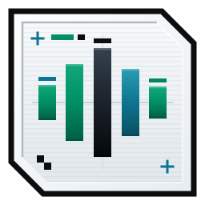
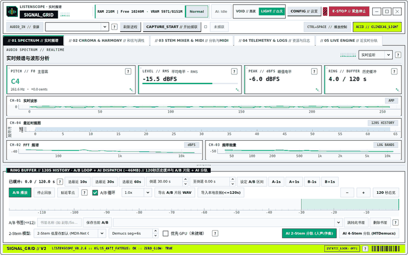
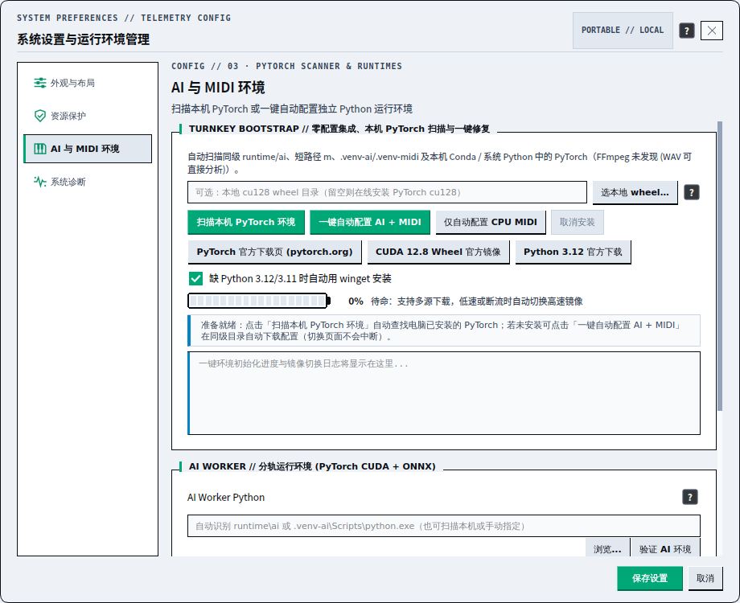
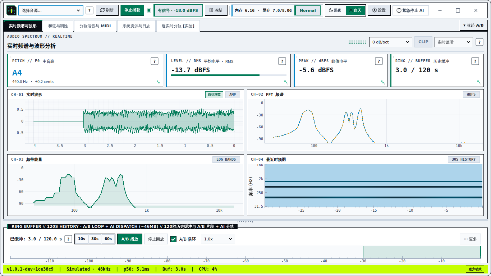
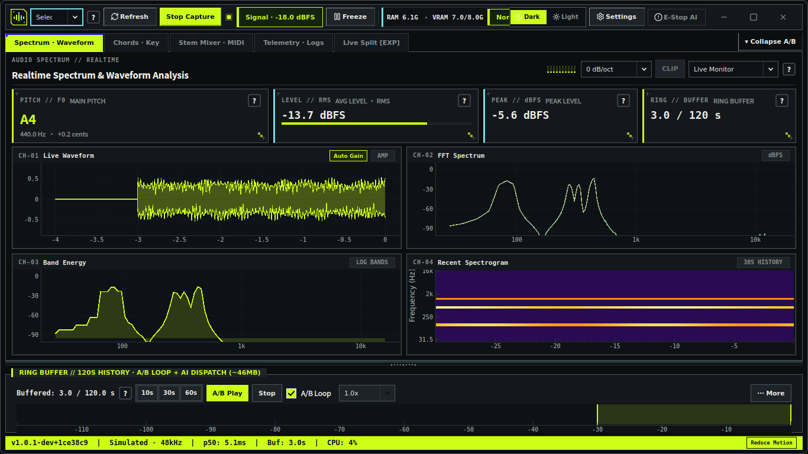
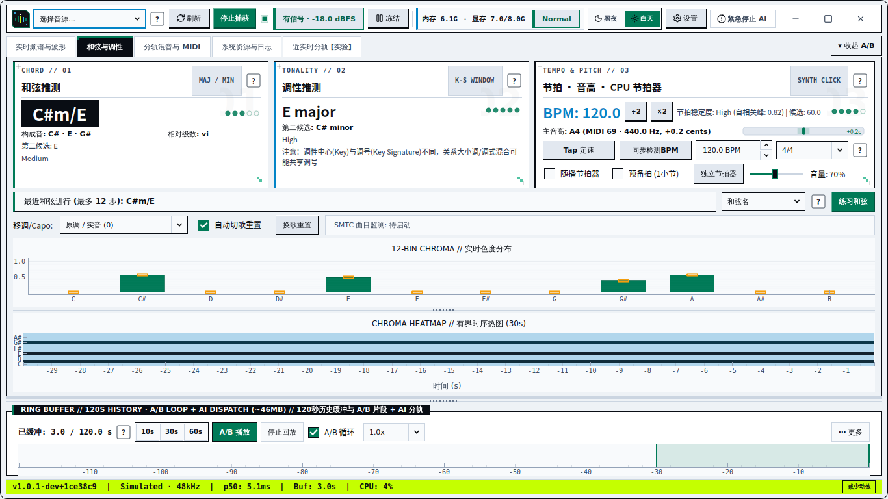
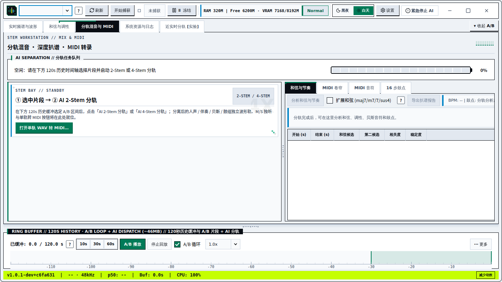

<div align="center">

<picture>
  <source media="(prefers-color-scheme: dark)" srcset="docs/design/icon/listenscope_master_dark.svg" />
  
</picture>

# ListenScope

**無料 · オフライン · ローカル動作**の Windows 向け音楽解析・A/B ループ・耳コピ練習ワークステーション

[简体中文](README.md) · [English](README.en.md) · [한국어](README.ko.md) · 日本語

<a href="https://github.com/Ceph-learner/ListenScope/releases"></a>

<a href="LICENSE"></a>

</div>

<br />

暗号化された音源キャッシュのダウンロードも、仮想オーディオデバイスの設定も不要です。プレイヤーやブラウザで普段どおり音楽を再生するだけで、ListenScope が Windows 標準のオーディオ API で再生中の音声をキャプチャし、リアルタイムのスペクトラム・音程解析、コード・調の認識、120 秒さかのぼれる A/B スロー再生、ローカル AI ステム分離、Cubase 互換の MIDI 書き出しを提供します。

<p align="center">
  
</p>

---

## クイックスタート

コマンドライン操作は不要です。次の手順ですぐに使い始められます。

1. **ダウンロード**：[Releases](https://github.com/Ceph-learner/ListenScope/releases) からインストーラー版 `ListenScope-Setup-Windows-x64.exe`、またはインストール不要のポータブル版 `ListenScope-Core-Windows-x64-Portable.zip` を入手します。
2. **起動**：`ListenScope.exe` を実行します。リアルタイムスペクトラム、コード / 調 / BPM 認識、120 秒 A/B スロー再生、メトロノームは**専用 GPU なしですぐに使えます**。
3. **AI ステム分離と MIDI の設定（任意）**：**設定 → AI と MIDI 環境** を開きます。
   - PyTorch / Conda 環境がすでにある場合は **「ローカルの PyTorch 環境をスキャン」** で自動検出します。
   - まだない場合は **「AI + MIDI をワンクリック設定」** で独立した実行環境を自動構築し、案内に従って再起動すれば反映されます。
4. **キャプチャ開始**：上部バーの音源ドロップダウンで音楽を再生中のアプリを選び、**キャプチャ開始** をクリックします。

> 設定ファイル（`settings.json`）、作業キャッシュ、書き出した WAV / MIDI は既定で**アプリと同じフォルダ**に保存され、`C:\` ドライブに余分なファイルを書き込みません。

<p align="center">
  
</p>

詳しい操作方法と代表的な耳コピの流れは [ユーザーガイド（英語）](docs/USER_GUIDE.en.md) をご覧ください。

---

## 主な機能

| モジュール | 内容 |
| :--- | :--- |
| **リアルタイムキャプチャとスペクトラム** | プロセス単位で特定のプレイヤーを、またはシステムループバックで PC 全体の出力をキャプチャ。波形、FFT / 対数スペクトラム、基本周波数 `F0`、`-50 ~ +50 cents` のチューニングメーター |
| **コード・調・Capo** | 12-bin Chroma ヒートマップ、メジャー / マイナートライアドと構成音、ローマ数字表記、コード履歴、CPU のみで動く **Capo 移調連動**、24 調のコード練習ウィンドウ（合成音での試聴と `.mid` 書き出し） |
| **120 秒さかのぼり再生と A/B 練習** | 直近 120 秒（`48 kHz / Stereo`）を常に保持。ドラッグで A/B 区間を指定し、`0.5x–1.25x` の音程を保った速度変更再生、練習ブックマーク、タップテンポ対応メトロノーム、練習用 WAV 書き出し |
| **ローカル AI ステム分離とミキサー** | 必要なときだけ 2 ステム（ボーカル / 伴奏）または 4 ステム（ボーカル / ドラム / ベース / その他）を分離。既定 6 秒単位で処理し、緊急停止で VRAM を即時解放。**`0–24 dB` のベースソロブースト**と最低音検出 |
| **MIDI 書き出し** | 分離したステムやローカルの WAV を MIDI に変換し、**Cubase 互換 SMF Type-0（`480 TPB`）**として書き出し |
| **テーマと多言語** | ライト / ダークをワンクリックで切り替え、複数の配色を内蔵。UI は **简体中文 / English / 한국어 / 日本語** をリアルタイムに切り替え可能 |

---

## スクリーンショット

<p align="center">
  
</p>

<table>
<tr>
<td align="center" width="33%"><br /><sub>ダークテーマ</sub></td>
<td align="center" width="33%"><br /><sub>コード · 調 · テンポ</sub></td>
<td align="center" width="33%"><br /><sub>ステムミキサーと MIDI</sub></td>
</tr>
</table>

<p align="center"><sub>スクリーンショットとデモはすべて合成信号で生成しています。</sub></p>

---

## 動作環境と既知の制限

| 項目 | 内容 |
| :--- | :--- |
| OS | Windows 10 / 11（64 ビット） |
| プロセス単位のキャプチャ | Windows 11 が必要です。Windows 10 ではシステムループバックで PC 全体の音声をキャプチャできます |
| GPU | 任意。AI ステム分離のみで使用（NVIDIA 推奨） |
| 主な検証環境 | Windows 11 · NVIDIA RTX 5060 Ti 8 GB · メモリ 16 GB |

- 既定の 6 秒チャンクと 3 段階のメモリ保護しきい値は、上記の検証環境に合わせて控えめに設定しています。その他の GPU、内蔵グラフィックス、システム構成はまだ十分に検証できていません。互換性や性能の問題があれば、ハードウェア情報と診断パッケージを添えて [Issues](https://github.com/Ceph-learner/ListenScope/issues) でお知らせください。
- フレームレスのメインウィンドウは、現時点で Windows 11 のスナップレイアウト（Snap Layouts：最大化ボタンにカーソルを合わせると表示されるメニュー）に対応していません。今後の対応を予定しています。
- 配布パッケージはまだコード署名されていないため、初回起動時に SmartScreen が表示される場合があります。「詳細情報 → 実行」を選んでください。各リリースの `SHA256SUMS.txt` でファイルの整合性を確認できます。

---

## よくある質問

- **NVIDIA の GPU がなくても使えますか？** 使えます。AI ステム分離以外の機能は CPU だけで動作します。
- **音声がキャプチャされない場合は？** 実際に音が出ているアプリを選んでいるか確認するか、システムループバックに切り替えてお試しください。
- **ウィンドウを閉じてもアプリが動いている？** システムトレイに最小化されている可能性があります。トレイアイコンを右クリックして「終了」を選んでください。
- **オンライン更新：** 「設定」画面からアップデートを確認できます（既定では 24 時間に最大 1 回自動確認し、オフにすることも可能です）。更新確認では GitHub 上の公開バージョン情報のみを読み取り、データは一切送信しません。ダウンロードした更新パッケージは各リリースの `SHA256SUMS.txt` で自動的に整合性を検証します。配布パッケージは未署名のため初回起動時に SmartScreen が表示される場合がありますが、「詳細情報 → 実行」で起動できます。Releases から手動で上書き更新することも可能です（ポータブル版は `settings.json` と `exports\` フォルダを残してください）。

その他の質問は [FAQ（英語）](docs/FAQ.en.md) と [用語集（英語）](docs/GLOSSARY.en.md) をご覧ください。

---

## ソースから実行

メイン UI を軽量に保つため（GPU なしでもリアルタイム解析と A/B 練習をすべて利用可能）、プロジェクトは互いに独立した 3 つの Python 環境で構成されています。

```text
ListenScope/
├── core/         # 設定とポータブルパス、多言語、外観、環境スキャン、リソース保護
├── audio/        # WASAPI キャプチャ、120 秒リングバッファ、WSOLA 速度変更、メトロノーム、ミキサー
├── analysis/     # スペクトラム / Chroma / コード / 調 / BPM、ベース音高、MIDI 書き出し
├── ai/           # 分離モデル登録、チャンク制御、独立 AI サブプロセス管理
├── separation/   # 2 ステム MDX-ONNX / 4 ステム HTDemucs バックエンド
├── streaming/    # 実験的な準リアルタイム 2 ステムモニタリング（既定はオフ）
├── ui/           # PySide6 + PyQtGraph デスクトップ UI
├── packaging/    # PyInstaller 設定と依存関係の制約
├── scripts/      # Windows ワンクリック初期化、ハードウェア検出、インストーラースクリプト
└── docs/         # アーキテクチャ、技術判断、開発・パッケージング文書
```

```powershell
# Windows：Core / AI / MIDI の 3 環境を初期化して起動
pwsh -ExecutionPolicy Bypass -File scripts\setup_windows.ps1
.\.venv-core\Scripts\python.exe main.py
```

```bash
# Linux / サウンドカードなし：シミュレーション信号で実行・テスト
pip install -r requirements-core.txt pytest
python main.py --simulate
QT_QPA_PLATFORM=offscreen python -m pytest -q --tb=short
```

関連ドキュメント：[アーキテクチャ](docs/ARCHITECTURE.md) · [技術判断](docs/DECISIONS.md) · [開発ガイド](docs/DEVELOPMENT.md) · [テスト](docs/TESTING.md) · [パッケージング](docs/PACKAGING.md) · [ロードマップ](ROADMAP.md) · [コントリビューション](CONTRIBUTING.md) · [行動規範](CODE_OF_CONDUCT.en.md)

---

## ライセンスと注意事項

- ソースコードは [MIT License](LICENSE) で公開しています。サードパーティ製コンポーネントとそのライセンスは [THIRD_PARTY_NOTICES.md](THIRD_PARTY_NOTICES.md) と [licenses/](licenses/)、アルゴリズムの参考文献は [PROVENANCE.md](docs/PROVENANCE.md) にまとめています。
- リポジトリと配布パッケージには AI モデルの重みファイルを**含みません**。UVR / MDX-Net、HTDemucs、Basic Pitch などのモデルはそれぞれのライセンスと利用条件に従います。ダウンロード前にご確認ください。
- すべての機能はローカルで動作し、テレメトリやデータ送信は一切ありません。詳しくは [PRIVACY.md](PRIVACY.md) をご覧ください。

<details>
<summary>免責事項と商標</summary>

<br />

- ListenScope はシステム標準のオーディオ API を通じて、PC で再生中の音声をキャプチャするだけです。ダウンロード、復号、DRM の回避は一切行いません。お住まいの地域の法令を守り、扱う音声の著作権を尊重してください。
- 本プロジェクトは音楽配信サービス、DAW、ハードウェアメーカーとは一切関係ありません。文中の QQ 音楽、Cubase、NVIDIA、Windows などは各権利者の商標です。
- 本ソフトウェアは「現状のまま」提供され、明示・黙示を問わずいかなる保証もありません。

</details>

---

## 謝辞

オーディオ信号処理、音源分離、MIDI 変換、そして Qt デスクトップエコシステムに携わるオープンソースプロジェクトと研究者の皆さまに感謝します。ListenScope は皆さまの成果の上に成り立っています。一覧と出典は [ACKNOWLEDGMENTS.md](ACKNOWLEDGMENTS.md) をご覧ください。

お役に立てましたら ⭐ をいただけると励みになります。ご提案やフィードバックも Issue でお気軽にお寄せください。
