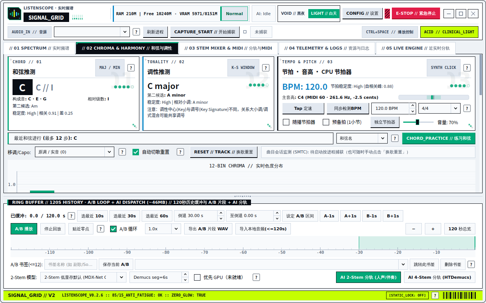

# ListenScope

<p align="left">
  <a href="README.md">简体中文</a> ·
  <a href="README.en.md">English</a> ·
  <a href="README.ko.md">한국어</a> ·
  <a href="README.ja.md">日本語</a>
</p>

<p align="left">
  
  
  
</p>

**無料・オフライン・ローカル動作**の Windows デスクトップ向け音楽解析・A/B ループ・AI ステム分離・耳コピ練習ワークステーションです。

暗号化された音源キャッシュのダウンロードや仮想オーディオドライバの設定は不要です。音楽プレイヤーやブラウザで再生中の音声を Windows 標準の WASAPI でプロセス単位にキャプチャし、リアルタイムスペクトラム、コード進行、調（Key）、BPM、120 秒区間リピート、ローカル AI ステム分離、Cubase 互換 MIDI エクスポートを提供します。

<p align="center">
  
</p>

---

## クイックスタート（コマンド不要・GUI でワンクリック設定）

1. **ダウンロード＆インストール**：[Releases](https://github.com/Ceph-learner/ListenScope/releases) から `ListenScope-Setup-Windows-x64.exe` または `ListenScope-Core-Windows-x64-Portable.zip` をダウンロードします。
2. **起動**：`ListenScope.exe` をダブルクリックします。**リアルタイムスペクトラム、コード/調/BPM 解析、120 秒 A/B 再生、メトロノームは GPU なしで即利用可能**です。
3. **GUI から AI & MIDI をワンクリック導入（任意）**：
   - 右上の **`CONFIG // 設定`** → **`AI & MIDI 環境`** を開きます。
   - すでに PyTorch / Conda が入っている場合は **ローカル PyTorch スキャン**、未導入の場合は **AI + MIDI ワンクリック自動構築**を押して再起動するだけです。
4. **解析開始**：上部の `AUDIO_IN` から再生中のアプリを選び、**`CAPTURE_START`** をクリックします。

<p align="center">
  
</p>

---

## 主な機能

| モジュール | 機能概要 |
| :--- | :--- |
| **リアルタイムキャプチャ & 解析** | プロセス単位 WASAPI ループバック（Build ≥ 20348）またはシステムループバック；OS 標準オーディオ API のみ使用（DRM 回避なし）；波形、FFT/対数スペクトラム、`F0` ピッチ＆`-50 ~ +50 cents` 音程バー |
| **コード・調性・カポ連動** | 12-bin Chroma ヒートマップ、ローマ数字度数、12 ステップ履歴、CPU **カポ/移調**、24 調コード練習ダイアログ（試聴・`.mid` 出力対応） |
| **120 秒 A/B ループ** | 固定 120 秒リングバッファ、ドラッグ A/B 指定、`0.5x–1.25x` 音程維持 WSOLA 再生速度変更、12 個のブックマーク、タップメトロノーム＆練習 WAV 出力 |
| **ローカル AI ステム & ミキサー** | 2-Stem / 4-Stem 分離（6 秒安全チャンク）、**`0–24 dB` ベースソロブースト**、`B0`/`E1` 対応 FFT-YIN ベース音高解析 |
| **MIDI & Cubase 対応** | ワンクリックでステムや WAV から MIDI 変換；出力をすべて **Steinberg Cubase 互換 SMF Type-0 (`480 TPB`)** に正規化 |
| **テーマ & 4 言語対応** | 初期テーマ **Acid Telemetry (Clinical Light)** とダークモード即座切替；Classic、アークティックスレート、グラファイト、ウォームサンド、**中/英/韓/日** 対応 |

<p align="center">
  
  
</p>

---

## ハードウェア互換性について

- 実機動作確認は主に **Windows 11 + NVIDIA RTX 5060 Ti (8 GB VRAM) + 16 GB RAM** 環境で行われています。
- その他の GPU や構成では未検証の部分があるため、不具合や動作報告は [Issues](https://github.com/Ceph-learner/ListenScope/issues) までお寄せください。

---

## 開発者向け：ソースからの実行・テスト

```powershell
pwsh -ExecutionPolicy Bypass -File scripts\setup_windows.ps1
.\.venv-core\Scripts\python.exe main.py
```

```bash
pip install -r requirements-core.txt pytest
python main.py --simulate
QT_QPA_PLATFORM=offscreen pytest -q --tb=short
```

---

## ドキュメント・ライセンス

- [アーキテクチャ (docs/ARCHITECTURE.md)](docs/ARCHITECTURE.md) · [設計判断 (docs/DECISIONS.md)](docs/DECISIONS.md) · [開発ガイド (docs/DEVELOPMENT.md)](docs/DEVELOPMENT.md) · [パッケージング (docs/PACKAGING.md)](docs/PACKAGING.md) · [コントリビュート (CONTRIBUTING.md)](CONTRIBUTING.md)
- [MIT License](LICENSE) · [ACKNOWLEDGMENTS.md](ACKNOWLEDGMENTS.md)
