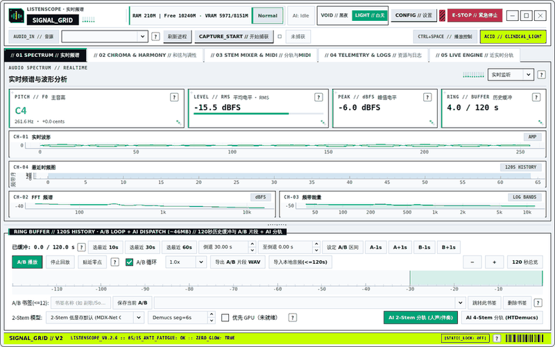
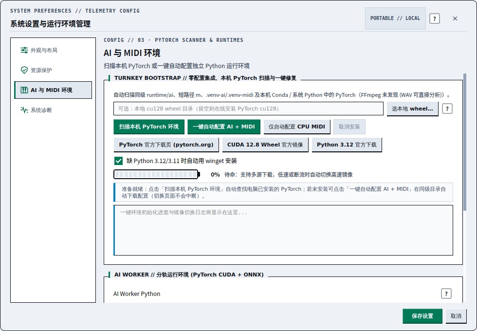
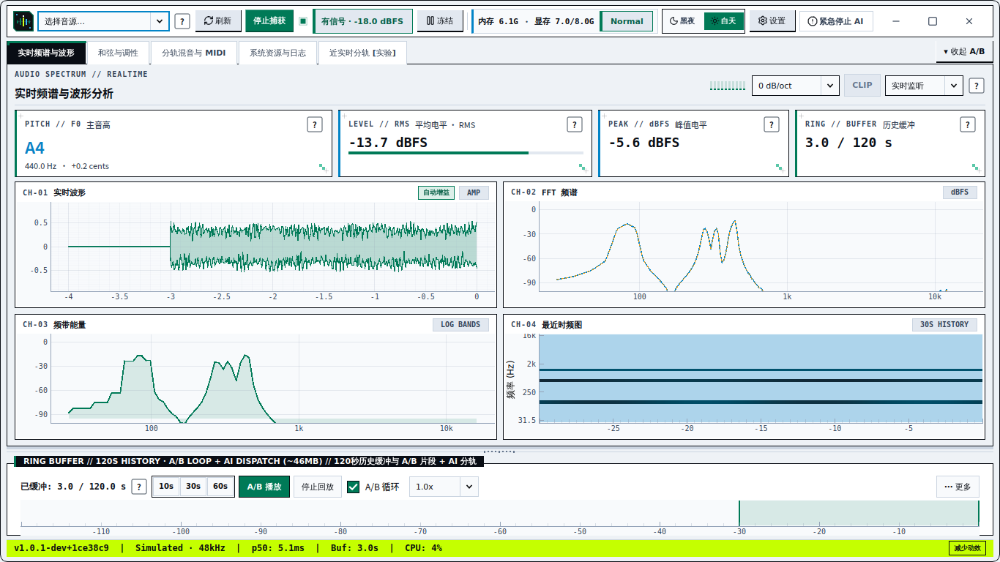
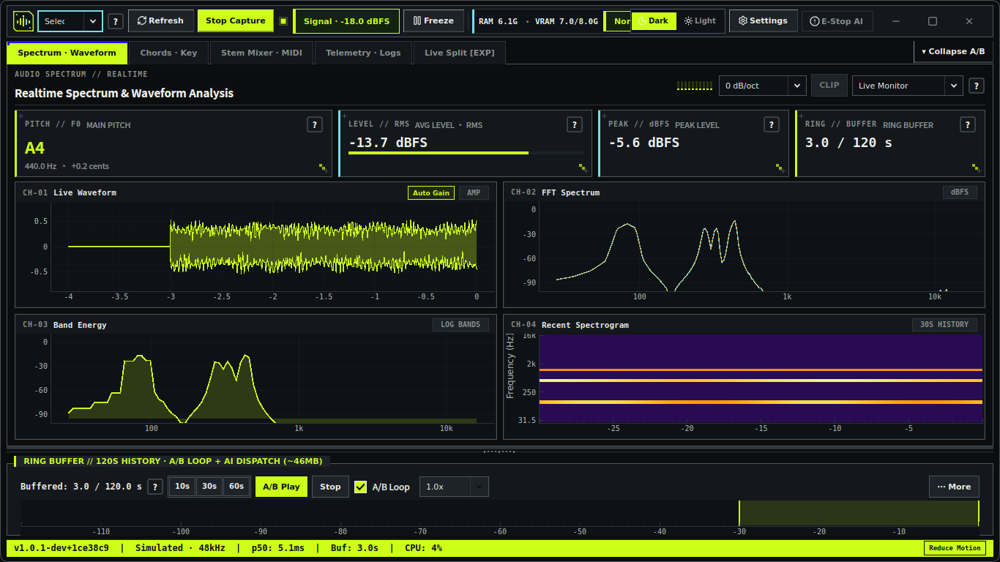
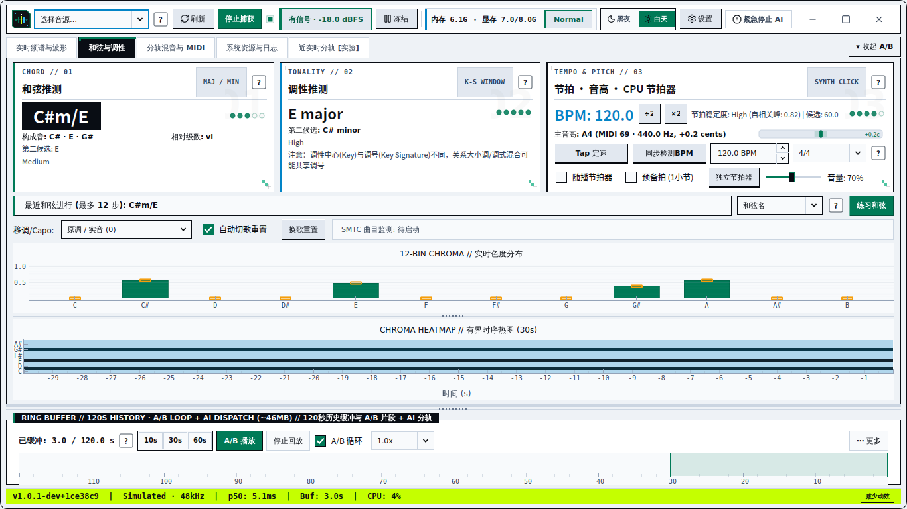
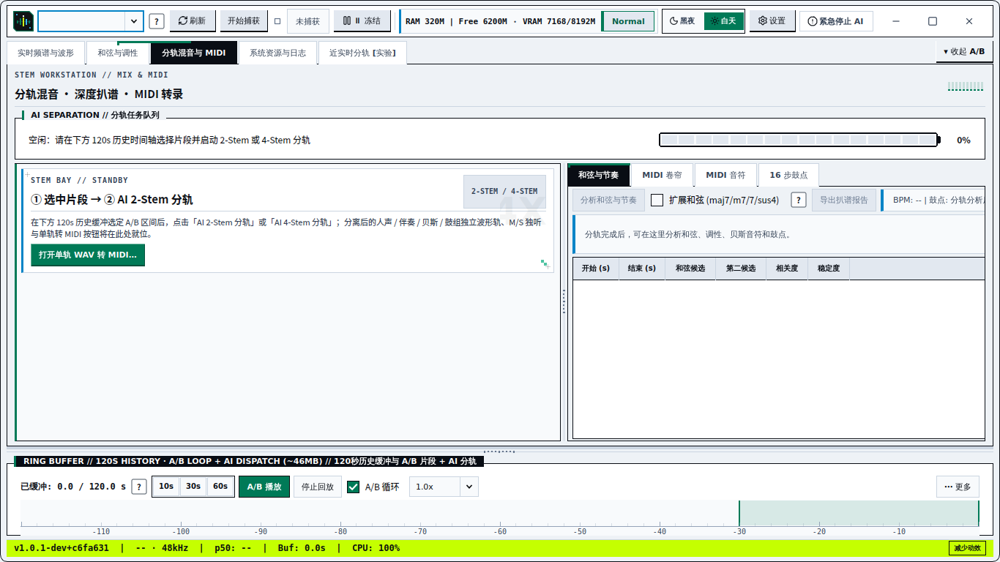

<div align="center">

<picture>
  <source media="(prefers-color-scheme: dark)" srcset="docs/design/icon/listenscope_master_dark.svg" />
  
</picture>

# ListenScope

**무료 · 오프라인 · 로컬 실행** Windows 음악 분석, A/B 반복, 채보 연습 워크스테이션

[简体中文](README.md) · [English](README.en.md) · 한국어 · [日本語](README.ja.md)

<a href="https://github.com/Ceph-learner/ListenScope/releases"></a>

<a href="LICENSE"></a>

</div>

<br />

암호화된 음원 캐시를 내려받거나 가상 오디오 장치를 설정할 필요가 없습니다. 플레이어나 브라우저에서 평소처럼 음악을 재생하면, ListenScope가 Windows 표준 오디오 API로 재생 중인 소리를 캡처하여 실시간 스펙트럼·음정 분석, 코드·조성 인식, 120초 되돌려 듣기 A/B 느린 재생, 로컬 AI 스템 분리, Cubase 호환 MIDI 내보내기를 제공합니다.

<p align="center">
  
</p>

---

## 빠른 시작

명령줄 없이 다음 단계만으로 바로 사용할 수 있습니다.

1. **다운로드**: [Releases](https://github.com/Ceph-learner/ListenScope/releases)에서 설치 버전 `ListenScope-Setup-Windows-x64.exe` 또는 설치가 필요 없는 포터블 버전 `ListenScope-Core-Windows-x64-Portable.zip`을 받습니다.
2. **실행**: `ListenScope.exe`를 실행합니다. 실시간 스펙트럼, 코드 / 조성 / BPM 인식, 120초 A/B 느린 재생, 메트로놈은 **별도의 GPU 없이 바로 사용할 수 있습니다**.
3. **AI 스템 분리 및 MIDI 설정(선택)**: **설정 → AI 및 MIDI 환경**을 엽니다.
   - PyTorch / Conda 환경이 이미 있다면 **「로컬 PyTorch 환경 스캔」**으로 자동 인식합니다.
   - 아직 없다면 **「AI + MIDI 원클릭 설정」**으로 독립 실행 환경을 자동 구성한 뒤, 안내에 따라 다시 시작하면 적용됩니다.
4. **캡처 시작**: 상단 바의 음원 드롭다운에서 음악을 재생 중인 프로그램을 선택하고 **캡처 시작**을 클릭합니다.

> 설정 파일(`settings.json`), 작업 캐시, 내보낸 WAV / MIDI는 기본적으로 **프로그램과 같은 폴더**에 저장되며, `C:\` 드라이브에 불필요한 파일을 쓰지 않습니다.

<p align="center">
  
</p>

자세한 사용법과 대표적인 채보 과정은 [사용자 가이드(영어)](docs/USER_GUIDE.en.md)를 참고하세요.

---

## 주요 기능

| 모듈 | 설명 |
| :--- | :--- |
| **실시간 캡처와 스펙트럼** | 프로세스 단위로 특정 플레이어를, 또는 시스템 루프백으로 PC 전체 출력을 캡처합니다. 파형, FFT / 로그 스펙트럼, 기본 주파수 `F0`, `-50 ~ +50 cents` 튜닝 미터 제공 |
| **코드, 조성, Capo** | 12-bin Chroma 히트맵, 장 / 단3화음과 구성음, 로마 숫자 표기, 코드 기록, CPU만으로 동작하는 **Capo 이조 연동**, 24개 조 코드 연습 창(합성음 미리 듣기와 `.mid` 내보내기 지원) |
| **120초 되돌려 듣기와 A/B 연습** | 최근 120초(`48 kHz / Stereo`)를 항상 보관합니다. 드래그로 A/B 구간을 지정하고 `0.5x–1.25x` 음정 유지 속도 변경 재생, 연습 북마크, 탭 템포 메트로놈, 연습용 WAV 내보내기 제공 |
| **로컬 AI 스템 분리와 믹서** | 필요할 때만 2스템(보컬 / 반주) 또는 4스템(보컬 / 드럼 / 베이스 / 기타) 분리를 실행합니다. 기본 6초 단위로 처리하며 긴급 정지로 VRAM을 즉시 해제. **`0–24 dB` 베이스 솔로 부스트**와 최저음 검출 지원 |
| **MIDI 내보내기** | 분리된 스템이나 로컬 WAV를 MIDI로 변환하여 **Cubase 호환 SMF Type-0(`480 TPB`)**으로 내보냅니다 |
| **테마와 다국어** | 라이트 / 다크 모드 원클릭 전환과 여러 기본 색상 테마를 제공하며, UI는 **简体中文 / English / 한국어 / 日本語** 실시간 전환을 지원합니다 |

---

## 스크린샷

<p align="center">
  
</p>

<table>
<tr>
<td align="center" width="33%"><br /><sub>다크 테마</sub></td>
<td align="center" width="33%"><br /><sub>코드 · 조성 · 템포</sub></td>
<td align="center" width="33%"><br /><sub>스템 믹서와 MIDI</sub></td>
</tr>
</table>

<p align="center"><sub>모든 스크린샷과 데모는 합성 신호로 생성되었습니다.</sub></p>

---

## 실행 환경과 알려진 제한 사항

| 항목 | 설명 |
| :--- | :--- |
| 운영체제 | Windows 10 / 11(64비트) |
| 프로세스 단위 캡처 | Windows 11이 필요합니다. Windows 10에서는 시스템 루프백으로 PC 전체 소리를 캡처할 수 있습니다 |
| GPU | 선택 사항이며 AI 스템 분리에만 사용합니다(NVIDIA 권장) |
| 주요 검증 환경 | Windows 11 · NVIDIA RTX 5060 Ti 8 GB · 메모리 16 GB |

- 기본 6초 청크와 3단계 메모리 보호 임계값은 위 검증 환경에 맞춰 보수적으로 설정되어 있습니다. 다른 GPU, 내장 그래픽, 시스템 구성은 아직 충분히 테스트되지 않았습니다. 호환성이나 성능 문제가 있다면 하드웨어 정보와 진단 패키지를 첨부하여 [Issues](https://github.com/Ceph-learner/ListenScope/issues)에 알려 주세요.
- 프레임리스 메인 창은 아직 Windows 11 스냅 레이아웃(Snap Layouts: 최대화 버튼에 마우스를 올리면 나타나는 메뉴)을 지원하지 않으며, 향후 지원할 예정입니다.
- 배포 패키지는 아직 코드 서명이 되어 있지 않아 처음 실행할 때 SmartScreen 경고가 표시될 수 있습니다. 「추가 정보 → 실행」을 선택하세요. 각 릴리스의 `SHA256SUMS.txt`로 파일 무결성을 확인할 수 있습니다.

---

## 자주 묻는 질문

- **NVIDIA GPU가 없어도 사용할 수 있나요?** 네. AI 스템 분리를 제외한 모든 기능은 CPU만으로 동작합니다.
- **소리가 캡처되지 않나요?** 실제로 소리가 나는 프로그램을 선택했는지 확인하거나 시스템 루프백으로 전환해 보세요.
- **창을 닫아도 프로그램이 실행 중인가요?** 시스템 트레이로 최소화되었을 수 있습니다. 트레이 아이콘을 오른쪽 클릭하고 「종료」를 선택하세요.
- **업데이트는 어떻게 하나요?** 현재는 Releases에서 새 버전을 내려받아 덮어써 주세요. 포터블 버전은 `settings.json`과 `exports\` 폴더를 유지하세요.

더 많은 질문은 [FAQ(영어)](docs/FAQ.en.md)와 [용어집(영어)](docs/GLOSSARY.en.md)을 참고하세요.

---

## 소스에서 실행

메인 UI를 가볍게 유지하기 위해(GPU 없이도 모든 실시간 분석과 A/B 연습 가능) 프로젝트는 서로 독립된 세 개의 Python 환경으로 구성됩니다.

```text
ListenScope/
├── core/         # 설정 및 포터블 경로, 다국어, 외관, 환경 스캔, 리소스 보호
├── audio/        # WASAPI 캡처, 120초 링 버퍼, WSOLA 속도 변경, 메트로놈, 믹서
├── analysis/     # 스펙트럼 / Chroma / 코드 / 조성 / BPM, 베이스 음높이, MIDI 내보내기
├── ai/           # 분리 모델 레지스트리, 청크 스케줄링, 독립 AI 서브프로세스 관리
├── separation/   # 2스템 MDX-ONNX / 4스템 HTDemucs 백엔드
├── streaming/    # 실험적 준실시간 2스템 모니터링(기본값 꺼짐)
├── ui/           # PySide6 + PyQtGraph 데스크톱 UI
├── packaging/    # PyInstaller 설정 및 의존성 제약
├── scripts/      # Windows 원클릭 초기화, 하드웨어 탐지, 설치 프로그램 스크립트
└── docs/         # 아키텍처, 기술 결정, 개발 및 패키징 문서
```

```powershell
# Windows: Core / AI / MIDI 세 환경을 초기화하고 실행
pwsh -ExecutionPolicy Bypass -File scripts\setup_windows.ps1
.\.venv-core\Scripts\python.exe main.py
```

```bash
# Linux / 사운드 카드 없음: 시뮬레이션 신호로 실행 및 테스트
pip install -r requirements-core.txt pytest
python main.py --simulate
QT_QPA_PLATFORM=offscreen python -m pytest -q --tb=short
```

관련 문서: [아키텍처](docs/ARCHITECTURE.md) · [기술 결정](docs/DECISIONS.md) · [개발 가이드](docs/DEVELOPMENT.md) · [테스트](docs/TESTING.md) · [패키징](docs/PACKAGING.md) · [로드맵](ROADMAP.md) · [기여 가이드](CONTRIBUTING.md) · [행동 강령](CODE_OF_CONDUCT.en.md)

---

## 라이선스와 고지

- 소스 코드는 [MIT License](LICENSE)로 공개됩니다. 서드파티 구성 요소와 라이선스는 [THIRD_PARTY_NOTICES.md](THIRD_PARTY_NOTICES.md)와 [licenses/](licenses/)에, 알고리즘 참고 문헌은 [PROVENANCE.md](docs/PROVENANCE.md)에 정리되어 있습니다.
- 저장소와 배포 패키지에는 AI 모델 가중치가 **포함되어 있지 않습니다**. UVR / MDX-Net, HTDemucs, Basic Pitch 등의 모델은 각각의 라이선스와 이용 약관을 따르므로 다운로드 전에 확인해 주세요.
- 모든 기능은 로컬에서 실행되며 원격 측정이나 데이터 업로드가 없습니다. 자세한 내용은 [PRIVACY.md](PRIVACY.md)를 참고하세요.

<details>
<summary>면책 및 상표 고지</summary>

<br />

- ListenScope는 시스템 표준 오디오 API를 통해 PC에서 재생 중인 소리만 캡처하며, 다운로드·복호화·DRM 우회를 일절 하지 않습니다. 해당 지역의 법령을 준수하고, 다루는 음원의 저작권을 존중해 주세요.
- 본 프로젝트는 음악 플랫폼, DAW, 하드웨어 제조사와 아무런 관련이 없습니다. 본문에 언급된 QQ Music, Cubase, NVIDIA, Windows 등은 각 권리자의 상표입니다.
- 본 소프트웨어는 「있는 그대로」 제공되며, 명시적이든 묵시적이든 어떠한 보증도 하지 않습니다.

</details>

---

## 감사의 말

오디오 신호 처리, 음원 분리, MIDI 변환, Qt 데스크톱 생태계의 오픈소스 프로젝트와 연구자분들께 감사드립니다. ListenScope는 이분들의 성과 위에 만들어졌습니다. 전체 목록과 출처는 [ACKNOWLEDGMENTS.md](ACKNOWLEDGMENTS.md)를 참고하세요.

도움이 되셨다면 ⭐를 눌러 주세요. 제안과 피드백도 Issue로 언제든 환영합니다.
