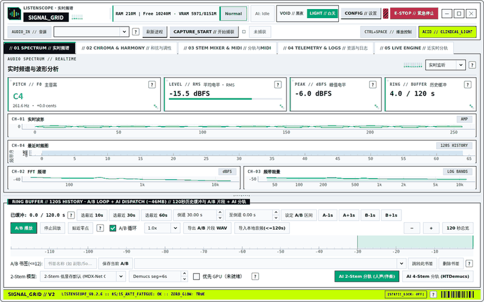
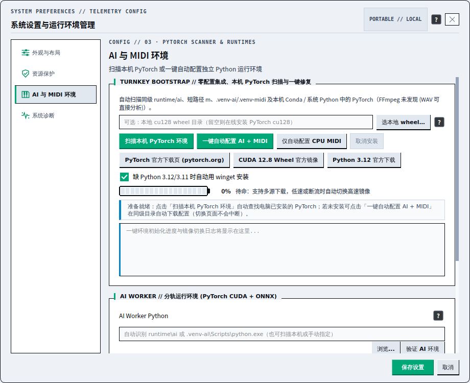
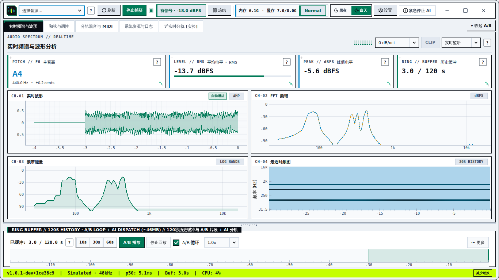
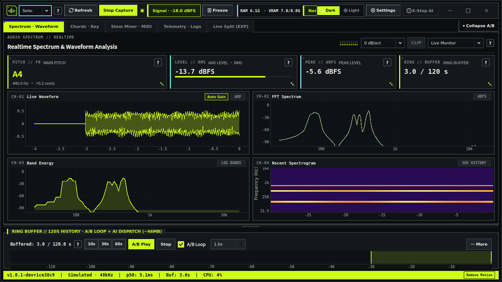
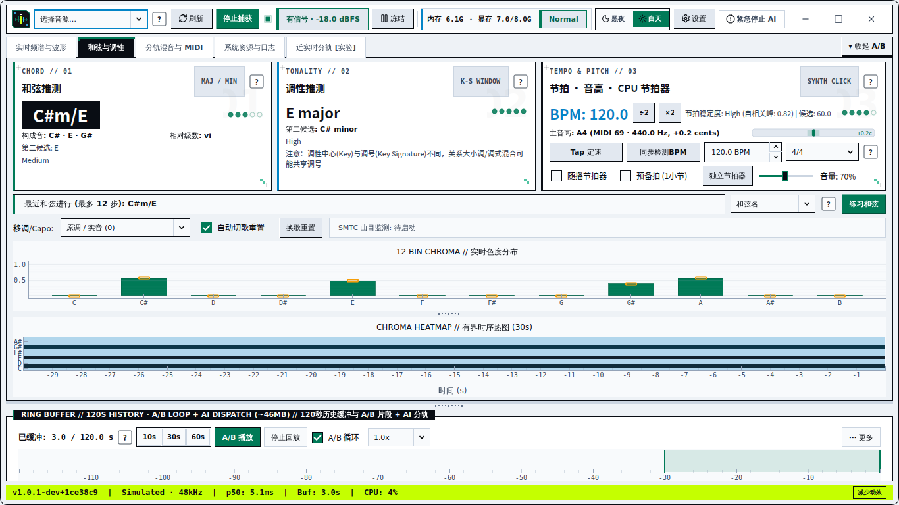
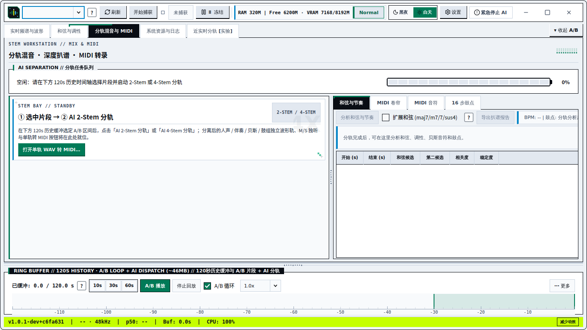

<div align="center">

<picture>
  <source media="(prefers-color-scheme: dark)" srcset="docs/design/icon/listenscope_master_dark.svg" />
  
</picture>

# ListenScope

**免费 · 离线 · 本地运行**的 Windows 听歌分析、A/B 循环与扒谱练习工作台

简体中文 · [English](README.en.md) · [한국어](README.ko.md) · [日本語](README.ja.md)

<a href="https://github.com/Ceph-learner/ListenScope/releases"></a>

<a href="LICENSE"></a>

</div>

<br />

无需下载加密音乐缓存，也不必配置虚拟声卡。在播放器或浏览器中正常听歌时，ListenScope 通过 Windows 标准音频接口捕获正在播放的声音，实时提供频谱与音准分析、和弦与调性识别、120 秒回溯 A/B 慢放、本地 AI 分轨以及 Cubase 兼容的 MIDI 导出。

<p align="center">
  
</p>

---

## 快速上手

无需命令行，按以下步骤即可开始使用：

1. **下载**：前往 [Releases](https://github.com/Ceph-learner/ListenScope/releases) 下载安装版 `ListenScope-Setup-Windows-x64.exe`，或免安装的便携版 `ListenScope-Core-Windows-x64-Portable.zip`。
2. **启动**：运行 `ListenScope.exe`。实时频谱、和弦 / 调性 / BPM 识别、120 秒 A/B 慢放与节拍器**开箱即用，无需独立显卡**。
3. **配置 AI 分轨与 MIDI（可选）**：打开 **设置 → AI 与 MIDI 环境**。
   - 本机已有 PyTorch / Conda 环境时，点击 **「扫描本机 PyTorch 环境」** 自动识别；
   - 尚未安装时，点击 **「一键自动配置 AI + MIDI」** 自动部署独立运行环境，完成后按提示重启即可生效。
4. **开始捕获**：在顶栏音源下拉框中选择正在播放音乐的程序，点击 **开始捕获**。

> 配置文件（`settings.json`）、工作区缓存与导出的 WAV / MIDI 默认保存在**软件同级目录**，不会向 `C:\` 盘写入多余文件。

<p align="center">
  
</p>

详细的操作说明与典型扒谱流程见 [用户指南](docs/USER_GUIDE.md)。

---

## 核心功能

| 模块 | 功能说明 |
| :--- | :--- |
| **实时捕获与频谱** | 按进程捕获指定播放器的声音，或使用系统环回捕获整机输出；提供波形、FFT / 对数频谱、基频 `F0` 与 `-50 ~ +50 cents` 音准刻度条 |
| **和弦、调性与 Capo** | 12-bin Chroma 热图、大 / 小三和弦与构成音识别、罗马级数、和弦轨迹、纯 CPU **Capo 移调联动**，以及 24 调和弦练习窗（支持合成试听与 `.mid` 导出） |
| **120 秒回溯与 A/B 练习** | 始终保留最近 120 秒音频（`48 kHz / Stereo`）；拖拽框选 A/B 区间，`0.5x–1.25x` 变速不变调回放，配合练习书签、Tap 定速节拍器与练习 WAV 导出 |
| **本地 AI 分轨与混音** | 按需运行 2 轨（人声 / 伴奏）或 4 轨（人声 / 鼓组 / 贝斯 / 其他）分离，默认 6 秒分块并可随时急停释放显存；支持 **`0–24 dB` 贝斯独听增益**与贝斯最低音检测 |
| **MIDI 导出** | 分轨后的单轨或本地 WAV 均可转写为 MIDI，统一导出为 **Cubase 兼容 SMF Type-0（`480 TPB`）** |
| **主题与多语言** | 亮 / 暗模式一键切换，内置多套配色；界面支持 **简体中文 / English / 한국어 / 日本語** 实时切换 |

---

## 界面预览

<p align="center">
  
</p>

<table>
<tr>
<td align="center" width="33%"><br /><sub>深色主题</sub></td>
<td align="center" width="33%"><br /><sub>和弦 · 调性 · 节拍</sub></td>
<td align="center" width="33%"><br /><sub>分轨混音与 MIDI</sub></td>
</tr>
</table>

<p align="center"><sub>以上截图与演示均使用合成信号生成。</sub></p>

---

## 运行环境与已知限制

| 项目 | 说明 |
| :--- | :--- |
| 操作系统 | Windows 10 / 11（64 位） |
| 按进程捕获 | 需要 Windows 11；Windows 10 可使用系统环回捕获整机声音 |
| 显卡 | 可选，仅 AI 分轨使用（推荐 NVIDIA 显卡） |
| 主要验证环境 | Windows 11 · NVIDIA RTX 5060 Ti 8 GB · 16 GB 内存 |

- 默认的 6 秒分块与三级内存保护阈值均按上述验证环境保守设定。其他显卡、核显或系统配置尚未全面测试，如遇到兼容或性能问题，欢迎在 [Issues](https://github.com/Ceph-learner/ListenScope/issues) 反馈硬件信息与诊断包。
- 无边框主窗口暂不支持 Windows 11 贴靠布局（Snap Layouts，即悬停最大化按钮时弹出的布局菜单），已列入后续计划。
- 发行包暂未进行代码签名，首次运行时 Windows 可能弹出 SmartScreen 提示，点击「更多信息 → 仍要运行」即可。可对照 Release 中的 `SHA256SUMS.txt` 校验文件完整性。

---

## 常见问题

- **没有 NVIDIA 显卡能用吗？** 可以。除 AI 分轨外，其余功能只需 CPU。
- **捕获不到声音？** 请确认选择的是正在发声的程序，或切换为系统环回再试。
- **关闭窗口后程序仍在运行？** 可能已最小化到系统托盘，右键托盘图标选择「退出」即可。
- **在线更新：** 可在「设置」中检查更新（默认每 24 小时最多自动检查一次，可关闭）。检查更新仅读取 GitHub 上公开的版本信息，不上传任何数据；下载的更新包会自动对照 Release 中的 `SHA256SUMS.txt` 校验完整性。发行包暂未进行代码签名，首次运行新版时 Windows 可能弹出 SmartScreen 提示，点击「更多信息 → 仍要运行」即可。也可手动从 Releases 下载新版覆盖（便携版请保留 `settings.json` 与 `exports\` 文件夹）。

更多问题见 [FAQ](docs/FAQ.md) 与 [术语表](docs/GLOSSARY.md)。

---

## 从源码运行

为保证主界面轻量（无显卡也能运行全部实时分析与 A/B 练习），项目采用三个相互隔离的 Python 环境：

```text
ListenScope/
├── core/         # 配置与便携路径、多语言、外观、环境扫描与资源保护
├── audio/        # WASAPI 捕获、120 s 环形缓冲、WSOLA 变速、节拍器与混音
├── analysis/     # 频谱 / Chroma / 和弦 / 调性 / BPM、贝斯音高与 MIDI 导出
├── ai/           # 分轨模型注册表、分块调度与独立 AI 子进程管理
├── separation/   # 2 轨 MDX-ONNX 与 4 轨 HTDemucs 后端
├── streaming/    # 实验性近实时 2 轨监听（默认关闭）
├── ui/           # PySide6 + PyQtGraph 桌面界面
├── packaging/    # PyInstaller 打包与依赖约束
├── scripts/      # Windows 一键初始化、硬件探测与安装包脚本
└── docs/         # 架构、技术决策、开发与打包文档
```

```powershell
# Windows：初始化 Core / AI / MIDI 三个环境并启动
pwsh -ExecutionPolicy Bypass -File scripts\setup_windows.ps1
.\.venv-core\Scripts\python.exe main.py
```

```bash
# Linux / 无声卡环境：使用模拟信号运行与测试
pip install -r requirements-core.txt pytest
python main.py --simulate
QT_QPA_PLATFORM=offscreen python -m pytest -q --tb=short
```

相关文档：[架构设计](docs/ARCHITECTURE.md) · [技术决策](docs/DECISIONS.md) · [开发指南](docs/DEVELOPMENT.md) · [测试说明](docs/TESTING.md) · [打包文档](docs/PACKAGING.md) · [路线图](ROADMAP.md) · [贡献指南](CONTRIBUTING.md) · [行为准则](CODE_OF_CONDUCT.md)

---

## 许可证与声明

- 本项目代码基于 [MIT License](LICENSE) 开源。第三方组件及其许可证见 [THIRD_PARTY_NOTICES.md](THIRD_PARTY_NOTICES.md) 与 [licenses/](licenses/)，算法参考文献见 [PROVENANCE.md](docs/PROVENANCE.md)。
- 仓库与发行包**不包含**任何 AI 模型权重；UVR / MDX-Net、HTDemucs、Basic Pitch 等模型遵循各自的许可与使用条款，请在下载前自行确认。
- 所有功能均在本地运行，无遥测、无数据上传，详见 [PRIVACY.md](PRIVACY.md)。

<details>
<summary>免责与商标声明</summary>

<br />

- ListenScope 仅通过系统标准音频接口捕获本机正在播放的声音，不下载、不解密、不绕过任何 DRM 保护。请遵守所在地法律法规，并对所处理音频的版权自行负责。
- 本项目与任何音乐平台、DAW 或硬件厂商均无隶属或合作关系；文中提及的 QQ 音乐、Cubase、NVIDIA、Windows 等均为其各自权利人的商标。
- 本软件按「原样」提供，不附带任何明示或暗示的担保。

</details>

---

## 致谢

感谢音频信号处理、音源分离、MIDI 转写及 Qt 桌面生态中的开源项目与研究者，ListenScope 建立在他们的工作之上。完整名单与出处见 [ACKNOWLEDGMENTS.md](ACKNOWLEDGMENTS.md)。

如果这个工具对你有所帮助，欢迎点一个 ⭐，也欢迎通过 Issue 提出建议与反馈。
