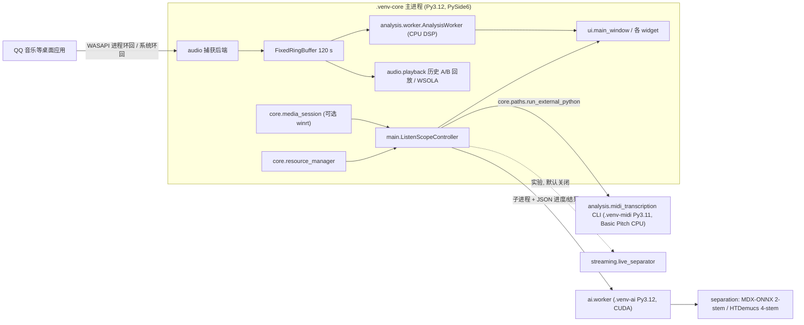

# 架构

目录树和逐模块说明见 [README 模块架构](../README.md#模块架构)，环境拆分理由见 [PACKAGING](PACKAGING.md) 第 1 节。本文件只补充进程边界、数据流和关键接口。决策依据见 [DECISIONS](DECISIONS.md)。

## 进程边界

## 关键数据流

1. **实时分析**：捕获后端（[process_loopback.py](../audio/process_loopback.py)、[system_loopback.py](../audio/system_loopback.py)）经有界队列写入 [`FixedRingBuffer`](../audio/ring_buffer.py)。[`AnalysisWorker`](../analysis/worker.py) 定期读取窗口，生成 `AnalysisSnapshot`（[core/models.py](../core/models.py)），由 UI 显示。
2. **历史回放与导出**：A/B 选区从环形缓冲取片段，经 [time_stretch.py](../audio/time_stretch.py)（WSOLA）和 [metronome.py](../audio/metronome.py) 处理后播放或分块导出 WAV。
3. **离线 AI 分轨**：主进程把片段写成 WAV，由 [`AIJobManager`](../ai/job_manager.py) 启动 [ai/worker.py](../ai/worker.py) 子进程（使用 `--ai-python` 或设置中保存的解释器）。Worker 按 6 秒分块调用 [separation/](../separation) 后端，通过 JSON 回报进度和结果。主进程用 [`ResourceManager`](../core/resource_manager.py) 监控内存和显存，必要时结束进程树。结果交给 [mixer_widget.py](../ui/mixer_widget.py) 和 [stem_analyzer.py](../analysis/stem_analyzer.py)。
4. **MIDI**：对单轨 WAV 调用 [`run_external_python`](../core/paths.py)，用 `.venv-midi` 解释器执行 [midi_transcription.py](../analysis/midi_transcription.py) 的 CLI。Basic Pitch 不可用时回退到轻量单音算法，并上报实际使用的算法。输出路径由 [main.py](../main.py) `_resolve_intermediate_midi_path` 决定。
5. **自动切歌**：[`WindowsMediaSessionReader`](../core/media_session.py) 读取 SMTC 会话，由 [`TrackChangeTracker`](../core/media_session.py) 防抖确认。确认是新曲目后，控制器触发与手动「换歌重置」相同的逻辑。
6. **设置**：[settings_store.py](../core/settings_store.py) 的 `PersistedSettings`（schema 2）保存阈值、解释器路径、练习参数和自动切歌开关。

## 技术栈

Python 3.11 / 3.12，PySide6 `<6.10`，pyqtgraph，numpy/scipy/librosa，soundfile，mido，psutil，nvidia-ml-py。AI 环境：PyTorch 2.11.0+cu128，onnxruntime-gpu 1.26，audio-separator 0.48，demucs 4.1。MIDI 环境：basic-pitch 0.4.0，TensorFlow 2.15.0。打包使用 PyInstaller（[listenscope_core.spec](../packaging/listenscope_core.spec)）。软件版本号见 [pyproject.toml](../pyproject.toml)（当前为 `0.2.0`）。
