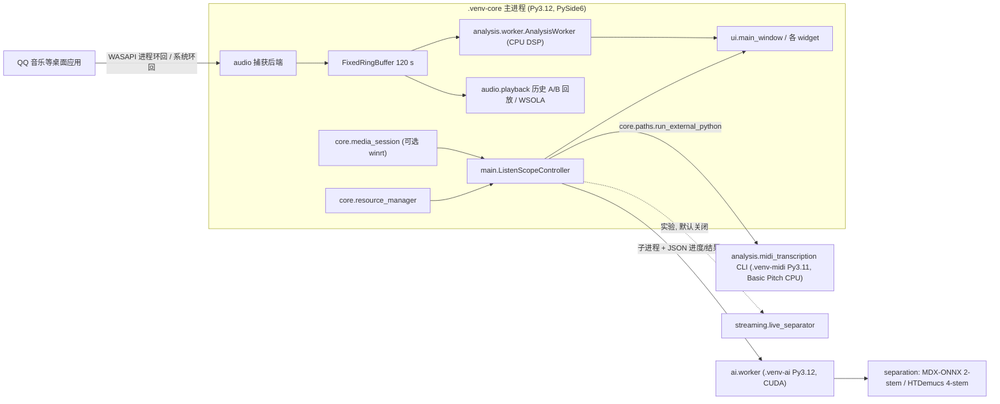

# 架构

目录树和逐模块说明见 [README 模块架构](../README.md#模块架构)，环境拆分理由见 [PACKAGING](PACKAGING.md) 第 1 节。本文件只补充进程边界、数据流和关键接口。决策依据见 [DECISIONS](DECISIONS.md)。

## 进程边界

## 关键数据流

1. **实时分析**：捕获后端（[process_loopback.py](../audio/process_loopback.py)、[system_loopback.py](../audio/system_loopback.py)）经有界队列写入 [`FixedRingBuffer`](../audio/ring_buffer.py)。[`AnalysisWorker`](../analysis/worker.py) 定期读取窗口，生成 `AnalysisSnapshot`（[core/models.py](../core/models.py)），由 UI 显示。
2. **历史回放与导出**：A/B 选区从环形缓冲取片段，经 [time_stretch.py](../audio/time_stretch.py)（WSOLA）和 [metronome.py](../audio/metronome.py) 处理后播放或分块导出 WAV。
3. **离线 AI 分轨与贝斯/和声深度分析**：主进程把片段写成 WAV，由 [`AIJobManager`](../ai/job_manager.py) 启动 [ai/worker.py](../ai/worker.py) 子进程（使用 `--ai-python`、同级便携运行时 `runtime/ai` 或设置中保存的解释器）。Worker 默认按 6 秒分块调用 [separation/](../separation) 后端。[流式写入](../ai/resource_guard.py) 只保留前一块的右侧重叠区，与后一块中相同时间位置的预测淡入淡出，每个源帧只写一次。Worker 通过 JSON 回报进度和结果，主进程用 [`ResourceManager`](../core/resource_manager.py) 监控内存和显存，必要时结束进程树。结果交给 [mixer_widget.py](../ui/mixer_widget.py) 和 [stem_analyzer.py](../analysis/stem_analyzer.py)；其中 [`analyze_bass_stem`](../analysis/stem_analyzer.py) 在 `28–350 Hz` 区间采用 FFT 加速 YIN (CMNDF) + 2 倍谐波防 8 度跃变 + 3 帧中值滤波计算最低音（低至 `B0`/`E1`）、MIDI 编号、频率及半程转调检测。
4. **Cubase 兼容标准 MIDI 流水线**：和弦进行导出（[chord_practice.py](../analysis/chord_practice.py)）、鼓点 MIDI（[drum_midi.py](../analysis/drum_midi.py)）以及单轨转录（[midi_transcription.py](../analysis/midi_transcription.py) 经 [`run_external_python`](../core/paths.py) 调用 `.venv-midi` / 短路径 `m` 运行 Basic Pitch 或回退轻量算法）统一接入 [`analysis/midi_common.py`](../analysis/midi_common.py)。所有产物标准化为 SMF Type-0 (`480 TPB`)，在 Tick 0 写入 ASCII 轨名、`time_signature`、`set_tempo`、圈内等音规范化 `key_signature`、Controller Reset (`CC 121=0`, `CC 64=0`, `pitchwheel=0`) 与 GM 音色号，裁切同通道同音高重叠并确保 `note_off < note_on`。
5. **自动切歌**：[`WindowsMediaSessionReader`](../core/media_session.py) 读取 SMTC 会话，由 [`TrackChangeTracker`](../core/media_session.py) 防抖确认。确认是新曲目后，控制器触发与手动「换歌重置」相同的逻辑。
6. **外观主题、字体、轻量化组件与同级便携存储**：
   - [`Appearance`](../core/appearance.py) 与 [`ui/appearance.py`](../ui/appearance.py) 支持 **黑夜 / 白天 / 跟随系统**（经 Qt 6.8 `styleHints().colorScheme()` 信号响应系统明暗变化并断开清理）、扫描系统字体、`11–20 px` 实时预览与恢复默认，并内置第 5 档预设 **「马拉松 (`marathon`)」**。
   - [`ui/marathon_style.py`](../ui/marathon_style.py) 提供独立隔离的马拉松工业临床视觉引擎（`is_marathon_eligible`、`resolve_marathon_variant`、`marathon_stylesheet`、`apply_marathon_plot_theme`、`marathon_colormap_lut`、`ChamferBadge`、`TelemetryHeader` 与 `_marathon_controls_qss`），通过随包 SVG 资产（`marathon_check.svg`、`marathon_chevron_*.svg`）消除原生 Fusion 3D 凸起边框而不影响经典/Lenso/Codex/Claude 主题；顶栏快切（`set_marathon_skin`）同步回写 `settings.json` 并联动更新 [`SettingsDialog`](../ui/settings_dialog.py) 左侧图标与主题摘要；切离马拉松时 [`appearance_stylesheet`](../ui/appearance.py) 保留顶栏与遥测卡片完整回退样式并同步刷新所有 `PlotWidget`。
   - [ui/chroma_widget.py](../ui/chroma_widget.py) 的 `TuningCentsBar` 提供 90ms `QVariantAnimation` 准音指针条，[`ui/help_badge.py`](../ui/help_badge.py) 提供紧凑型 `[?]` `HelpBadge`，[`ui/chord_practice.py`](../ui/chord_practice.py) 通过 `_PracticeTableDelegate` 对齐首行与表头，全程零 `QGraphicsEffect`。
   - [`core/paths.py`](../core/paths.py)（`default_work_dir`、`default_export_dir`、`get_app_root`）使 `settings.json`（[settings_store.py](../core/settings_store.py) schema 2）、`workspace_outputs/` 与 `exports/` 在软件目录可写时优先创建于程序同级目录（不写 `C:\`），并支持从同级 `runtime/ai`、`m`、`.venv-*` 自动探测解释器与通过 [`scripts/installer.iss`](../scripts/installer.iss) 构建免管理员安装器。

## 技术栈

Python 3.11 / 3.12，PySide6 `>=6.8,<6.10`（含 Qt 6.8 `colorScheme()`），pyqtgraph，numpy/scipy/librosa，soundfile，mido，psutil，nvidia-ml-py。AI 环境：PyTorch 2.11.0+cu128，onnxruntime-gpu 1.26，audio-separator 0.48，demucs 4.1。MIDI 环境：basic-pitch 0.4.0，TensorFlow 2.15.0。打包使用 PyInstaller（[listenscope_core.spec](../packaging/listenscope_core.spec)）及可选 Inno Setup 6（[`scripts/installer.iss`](../scripts/installer.iss)）。软件版本号见 [pyproject.toml](../pyproject.toml)（当前为 `0.2.0`）。
